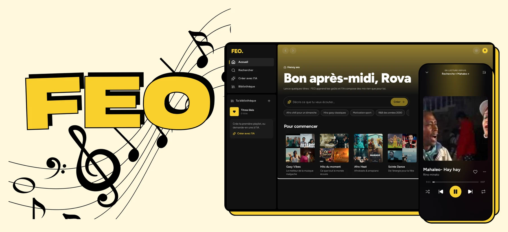
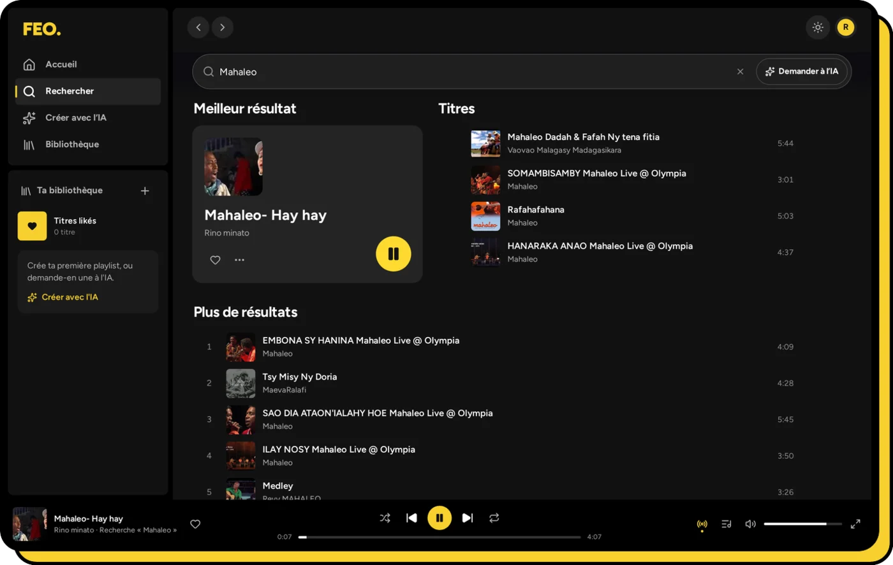
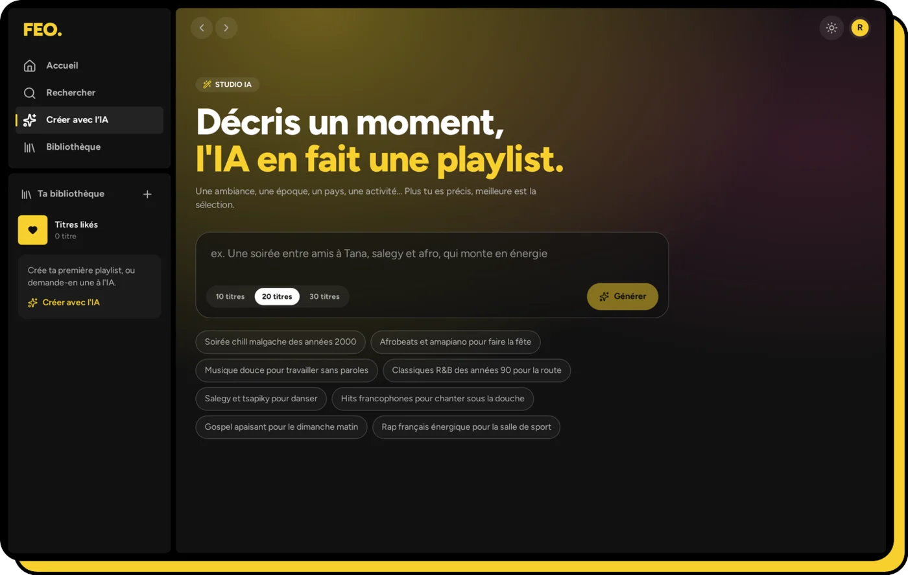
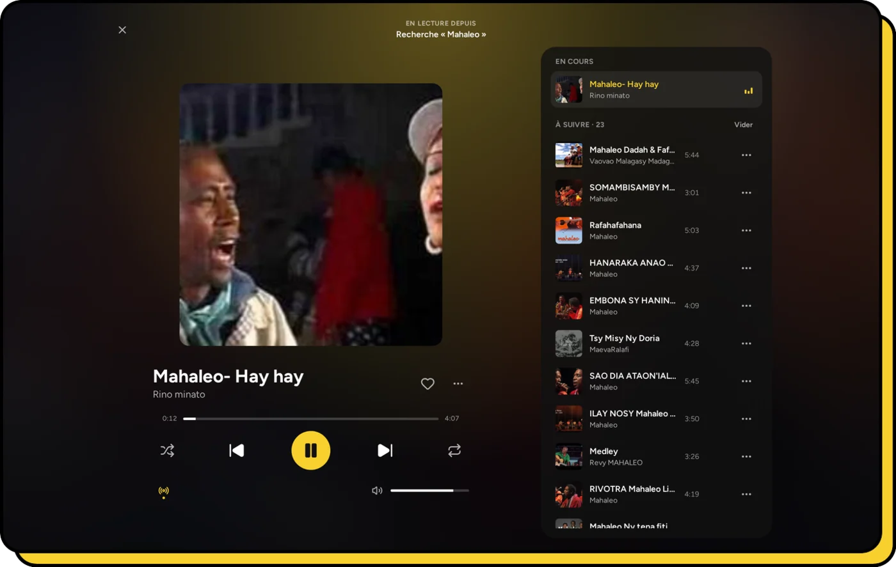
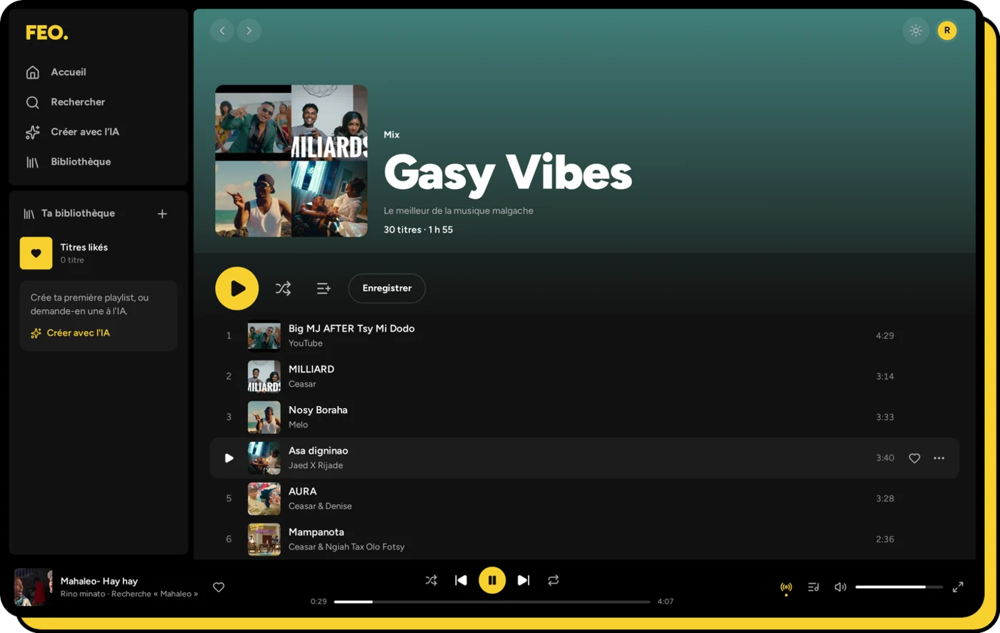
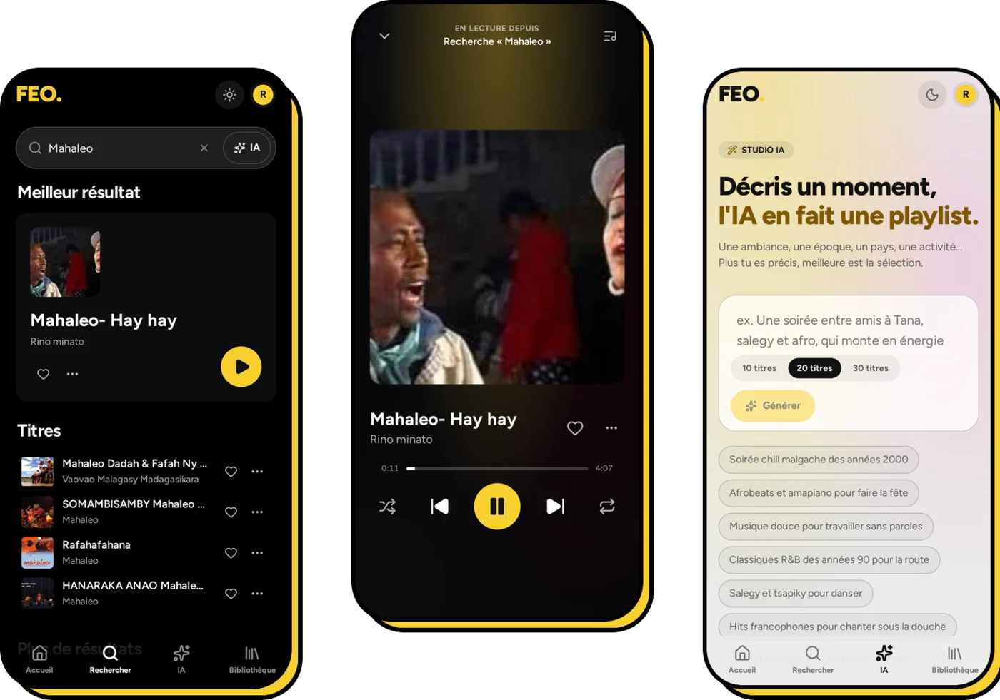
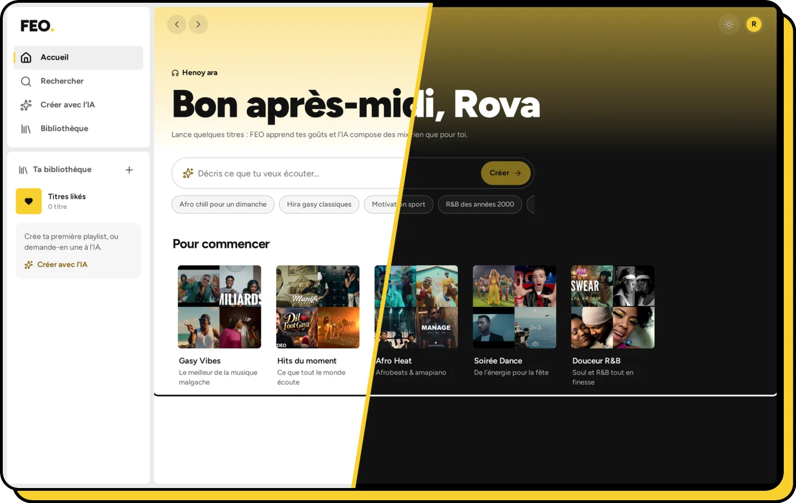

<div align="center">


### Henoy ara.

**A music player built on the YouTube catalogue, with an AI that keeps the music going.**<br />
Endless radio · playlists from a sentence · mixes that learn your taste · web and mobile.

<br />

[](https://react.dev)
[](https://expo.dev)
[](https://www.typescriptlang.org)
[](https://neon.tech)
<br />
[](#the-ai-never-leaves-you-in-silence)
[](#what-it-does)
[](#light-and-dark)
[](#on-your-phone)

<br />



</div>

<br />

---

<div align="center">

## What it does

</div>

<table align="center">
  <tr>
    <td align="center" width="33%">
      <h3>Endless radio</h3>
      <sub>When the queue runs low, the AI picks what comes next, with at most two songs per artist. If the AI is unavailable, a YouTube mix takes over without a pause.</sub>
    </td>
    <td align="center" width="33%">
      <h3>Playlist from a sentence</h3>
      <sub>Describe a moment, such as <i>"a night with friends in Tana, salegy and afro, building up"</i>, and get a playlist of 10, 20 or 30 songs you can play and save.</sub>
    </td>
    <td align="center" width="33%">
      <h3>Search by description</h3>
      <sub>Type <i>"the 2010 World Cup song that goes waka waka"</i>. The AI works out the song, and FEO finds the best matching video.</sub>
    </td>
  </tr>
  <tr>
    <td align="center">
      <h3>Mixes made for you</h3>
      <sub>The home page builds mixes from what you finish, skip and like, and refreshes them in the background.</sub>
    </td>
    <td align="center">
      <h3>Songs, not videos</h3>
      <sub>Films, radio dramas, TV sketches, full albums, concerts, shorts and hour-long compilations are filtered out.</sub>
    </td>
    <td align="center">
      <h3>Your library</h3>
      <sub>Likes, editable playlists, listening history, a full-screen player with its queue, and keyboard shortcuts.</sub>
    </td>
  </tr>
</table>

---

<div align="center">

## A tour

</div>

<table>
  <tr>
    <td width="50%" valign="top">
      
      <p align="center"><b>Search</b><br /><sub>A top result, songs and more results. Switch to <b>Ask the AI</b> to search by description.</sub></p>
    </td>
    <td width="50%" valign="top">
      
      <p align="center"><b>AI studio</b><br /><sub>Describe a moment, pick a length, or start from a suggestion.</sub></p>
    </td>
  </tr>
  <tr>
    <td width="50%" valign="top">
      
      <p align="center"><b>Now playing</b><br /><sub>Full-screen player with the queue next to it. The radio adds songs as you listen.</sub></p>
    </td>
    <td width="50%" valign="top">
      
      <p align="center"><b>Mixes</b><br /><sub>Each mix's header colour comes from its cover art. Play it, shuffle it or save it as a playlist.</sub></p>
    </td>
  </tr>
</table>

---

<div align="center">

## On your phone



<sub>The web app works on phones, and the <b>Expo</b> app runs natively on iOS and Android.<br />
Both use the same design tokens, the same player logic and the same API. On mobile, playback continues in the background and on the lock screen.</sub>

</div>

---

<div align="center">

## Light and dark



<sub>The logo's yellow is the only accent colour. On a light background it becomes a deep ochre for text, so it stays readable.<br />
FEO follows the system theme until you choose one.</sub>

</div>

---

## The AI never leaves you in silence

Free AI models are slow, rate-limited and sometimes down. FEO is built to keep playing anyway:

```
  your request
       │
       ▼
  ┌─────────────────────────────────────────────────────────────┐
  │  model chain, sorted by measured latency (EWMA)             │
  │  AI_MODEL_FAST ─► AI_MODEL ─► AI_MODEL_ALT ─► AI_FALLBACK   │
  └─────────────────────────────────────────────────────────────┘
       │ every model failed, timed out or hit its quota
       ▼
  non-AI fallback, returned instantly
       radio      → YouTube mix of the current song
       playlist   → selection from a YouTube search
       search     → regular search
```

| Choice | Why |
| --- | --- |
| **Latency-aware routing** | Each model's real response time is tracked and the fastest one is tried first |
| **Reasoning turned off** | With reasoning on, some models took about 90 s. Without it, they answer in 7 to 15 s |
| **Instant fallbacks** | Free OpenRouter models allow **50 requests per day** without credits. Past that, the AI pauses until the daily reset and every feature falls back to a non-AI result |
| **AI is optional** | Leave `LLM_API_KEY` empty and the app runs fully on the fallbacks |

---

## Built to survive YouTube

- **yt-dlp runs asynchronously** and its results are cached, so the home page never waits on a YouTube search.
- **The audio proxy supports HTTP Range requests and serves audio in slices**, and it resumes slices that were interrupted. Seeking stays instant and long songs don't cut out.
- **Anti-bot back-off:** when YouTube asks for a challenge, the API pauses yt-dlp for 3 minutes and returns `503 YOUTUBE_BLOCKED` instead of failing silently. Adding cookies makes these challenges much rarer.
- **Gzip JSON**, **one SQL statement per playlist write**, **prefetched pages and split vendor chunks** keep everything fast.

---

## Getting started

### Prerequisites

| Tool | Version | Notes |
| --- | --- | --- |
| Node.js | ≥ 20 | Also used as yt-dlp's JavaScript runtime |
| PostgreSQL | any recent version | Local, or [Neon](https://neon.tech) |
| yt-dlp | ≥ 2026.10 **with extras** | `python3 -m pip install --user -U "yt-dlp[default]"` |

> [!IMPORTANT]
> `yt-dlp-ejs` and Node as the JavaScript runtime are **required**. Without them, YouTube cuts audio streams after about 1 MB.

### Web and API

```bash
git clone https://github.com/fatratra-png/feo.git && cd feo

cp apps/backend/.env.example apps/backend/.env    # DATABASE_URL, JWT_*, LLM_API_KEY…
npm --prefix apps/backend install
npm --prefix apps/web install

npm run dev:backend    # API → http://localhost:3001 (applies migrations on startup)
npm run dev:web        # web → http://localhost:5173
```

> [!WARNING]
> The backend loads the root `.env.local` **before** `apps/backend/.env`, and values already set are not overwritten.
> If the root file points to a hosted database, local development will use **that** database.

### Mobile (Expo SDK 58)

```bash
cd apps/mobile
npm install
cp .env.example .env    # EXPO_PUBLIC_API_URL=http://<your-computer's-LAN-IP>:3001/api
npx expo start          # scan the QR code with Expo Go, or press w for the web preview
```

On a phone, `localhost` means the phone itself, so the API URL must point to the computer that runs the backend.

---

## Configuration

Everything lives in `apps/backend/.env`:

| Variable | Purpose |
| --- | --- |
| `DATABASE_URL` | PostgreSQL connection (pooled on Neon) |
| `DATABASE_URL_UNPOOLED` | Direct connection used for migrations (Neon) |
| `JWT_SECRET`, `JWT_REFRESH_SECRET` | Access and refresh token signing |
| `PORT`, `FRONTEND_URL` | API port, and allowed CORS origins (comma-separated) |
| `LLM_BASE_URL`, `LLM_API_KEY` | OpenRouter endpoint and key. Leave the key empty to run without AI |
| `AI_MODEL`, `AI_MODEL_FAST`, `AI_MODEL_ALT`, `AI_FALLBACK_MODEL` | The model chain |
| `AI_TIMEOUT_MS`, `AI_DAILY_LIMIT_PER_USER` | Per-call timeout and daily quota per user |
| `YTDLP_COOKIES` or `YTDLP_COOKIES_FROM_BROWSER` | Optional YouTube cookies (a `cookies.txt` file, or a browser name like `firefox`) |

The web app only needs `VITE_API_URL` at build time. It must not contain any secret.

---

## Keyboard shortcuts

| Key | Action | Key | Action |
| :---: | --- | :---: | --- |
| <kbd>Space</kbd> | Play / pause | <kbd>M</kbd> | Mute |
| <kbd>←</kbd> <kbd>→</kbd> | Seek 5 s | <kbd>S</kbd> | Shuffle |
| <kbd>Shift</kbd> + <kbd>←</kbd> <kbd>→</kbd> | Previous / next song | <kbd>L</kbd> | Repeat mode |
| <kbd>↑</kbd> <kbd>↓</kbd> | Volume | <kbd>/</kbd> | Search |
| <kbd>Esc</kbd> | Close the full-screen player | | |

---

## Deployment

<table align="center">
  <tr>
    <td align="center" width="33%"><br /><b>Web on Vercel</b><br /><sub>Root <code>apps/web</code>, Vite preset, SPA fallback in <code>vercel.json</code></sub></td>
    <td align="center" width="33%"><br /><b>API on Render</b><br /><sub>Docker + <code>render.yaml</code> Blueprint, health check on <code>/api/health</code></sub></td>
    <td align="center" width="33%"><br /><b>Database on Neon</b><br /><sub>Pooled URL for queries, direct URL for migrations</sub></td>
  </tr>
</table>

The API must be a **long-running Node service**, not a serverless function: it runs yt-dlp and streams audio
with Range requests. The full guide is in [`DEPLOYMENT.md`](DEPLOYMENT.md) (in French).

---

## Architecture

```
feo/
├── apps/
│   ├── backend/            Express · PostgreSQL · zod
│   │   └── src/
│   │       ├── routes.ts           every endpoint, including the sliced, Range-aware audio proxy
│   │       ├── services/
│   │       │   ├── youtube.ts      async yt-dlp, caches, songs-only filter, best match
│   │       │   ├── ai.ts           radio, prompt playlists, smart search, home mixes
│   │       │   ├── llm.ts          model chain with latency-based routing
│   │       │   ├── library.ts      likes, plays, taste profile
│   │       │   ├── playlists.ts    playlist CRUD
│   │       │   └── auth.ts         JWT access and refresh tokens
│   │       └── migrate.ts          migrations applied on startup
│   ├── web/                React 19 · Vite · Tailwind v4 · Zustand · TanStack Query
│   │   └── src/
│   │       ├── stores/player.ts            queue, shuffle, repeat, radio
│   │       └── components/player/          AudioEngine, PlayerBar, NowPlaying
│   └── mobile/             Expo SDK 58 · React Native · React Navigation · expo-audio
│       └── src/theme/tokens.ts     same design tokens as the web
└── packages/shared/        shared types, constants and utilities
```

---

## Tests

```bash
npm test                                 # backend (Mocha + Chai) then web (Vitest)
npm --prefix apps/web run test:watch
npm --prefix apps/backend run typecheck
```

The backend tests cover JSON extraction from model output, latency-based model ordering, best-match selection
(which rejects covers and compilations), artist diversity and Range parsing. The web tests cover the player store.
See [`TESTING.md`](TESTING.md).

---

<div align="center">

## Built with

&nbsp;&nbsp;&nbsp;
&nbsp;&nbsp;&nbsp;
&nbsp;&nbsp;&nbsp;
&nbsp;&nbsp;&nbsp;
&nbsp;&nbsp;&nbsp;
&nbsp;&nbsp;&nbsp;
&nbsp;&nbsp;&nbsp;
&nbsp;&nbsp;&nbsp;
&nbsp;&nbsp;&nbsp;
&nbsp;&nbsp;&nbsp;
&nbsp;&nbsp;&nbsp;


<sub>Zustand · React Navigation · expo-audio · yt-dlp · OpenRouter · lucide · Mocha · Chai</sub>

<br /><br />

---


<sub><b>Henoy ara.</b> Press play, the AI keeps the music going.</sub>

</div>
